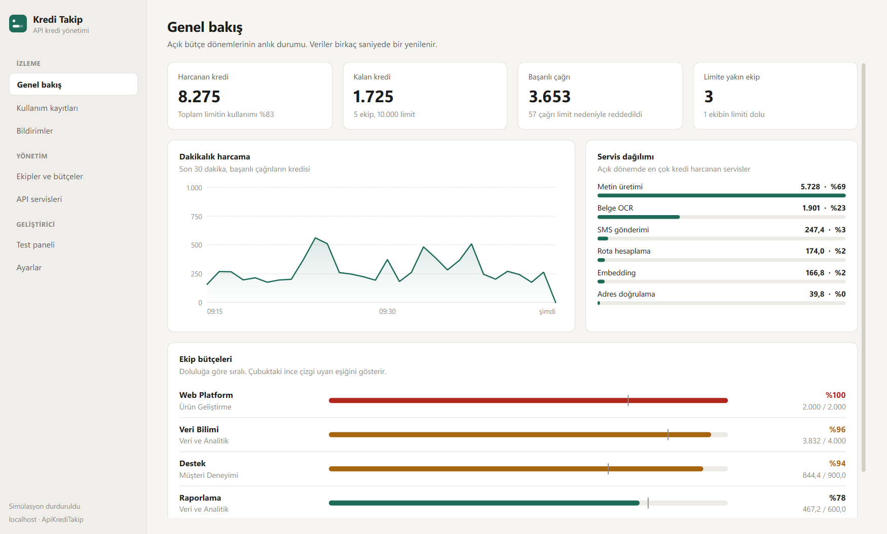

# Kredi Takip: Şirket İçi API Kredi Takip Sistemi

Farklı departman ve ekiplerin kullandığı harici veya dahili API servislerinin
tüketimini merkezi bir bütçe ve kota üzerinden yöneten masaüstü uygulaması.
Her ekibe tanımlanan kredi limiti sayesinde hangi servisin ne kadar çağrıldığı,
bütçenin nerede yoğunlaştığı ve limit aşımına ne kadar kaldığı anlık izlenir.

*BLM3001 Veritabanı Yönetim Sistemleri dersi projesi.* Python, PySide6 ve Microsoft SQL Server ile geliştirildi.



## Hızlı başlangıç

```powershell
winget install Microsoft.SQLServer.2022.Developer   # ücretsiz SQL Server
winget install Microsoft.msodbcsql.18               # ODBC sürücüsü
python -m venv .venv
.venv\Scripts\activate
pip install -r requirements.txt
python main.py
```

Veritabanı, tablolar ve örnek veri ilk açılışta otomatik oluşturulur. Ayrıntılar
için [docs/kurulum.md](docs/kurulum.md) dosyasına bakın.

## Özellikler

* Departman → ekip → kullanıcı hiyerarşisi. Ekip başına dönemlik kredi limiti ve uyarı eşiği.
* Harici ve dahili API servisleri. Birim bazlı fiyatlandırma: istek, 1K token, sayfa, mesaj.
* Ekip–servis erişim izinleri.
* Limit dolunca çağrılar reddedilir ve kayda geçer. Hatalı çağrılar ücretlendirilmez.
* Eşik ve limit bildirimleri: uygulama içi kart, okunmamış rozeti, Windows bildirimi.
* Dönem sıfırlama: elle, ekip bazında veya belirli aralıklarla otomatik. Geçmiş korunur.
* **Test paneli:** Sanal kullanıcı oluşturma veya var olan kullanıcıyı ID ile
  dahil etme. Dört davranış tipi, hız çarpanı, canlı akış.
* Açık ve koyu tema.

## Proje yapısı

| Klasör | İçerik |
|---|---|
| `main.py` | Giriş noktası |
| `core/` | Uygulama: `db/` (SQL Server), `services/` (iş kuralları), `connectors/` (API bağlayıcıları, `testusers/`), `ui/` (arayüz) |
| `tests/` | pytest testleri |
| `docs/` | [Dokümantasyon](docs/README.md) |

## Testler

```powershell
python -m pytest
```

SQL Server gerektiren entegrasyon testleri, sunucu yoksa otomatik atlanır. Bkz. [docs/test.md](docs/test.md).
