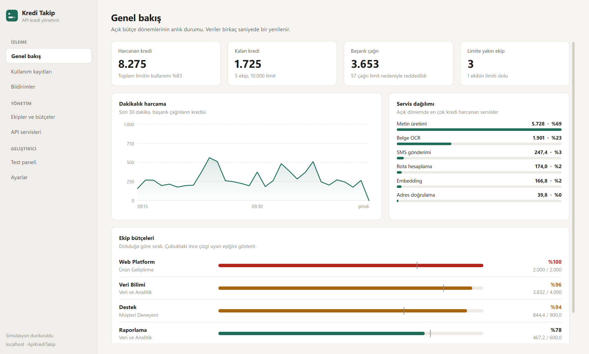
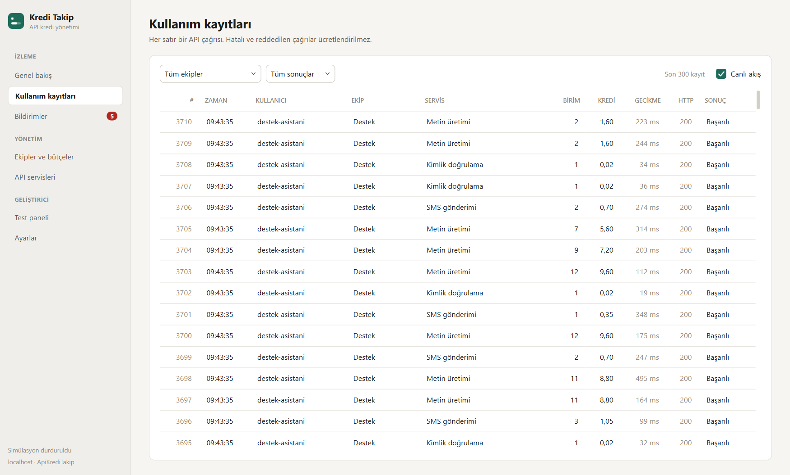
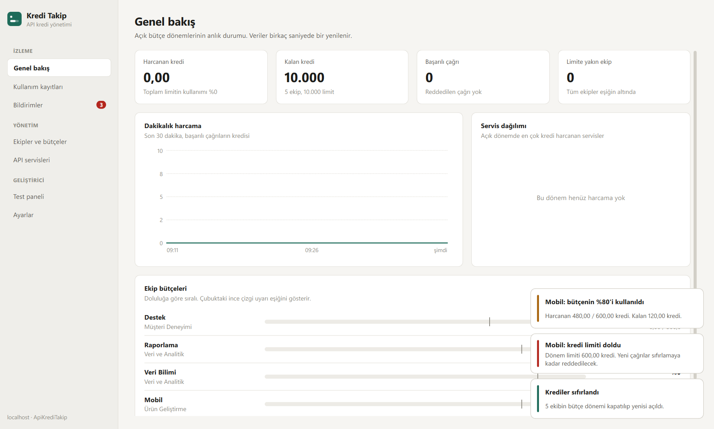
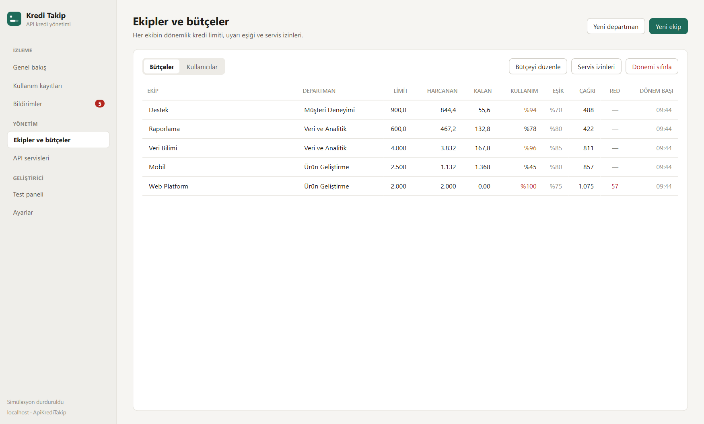
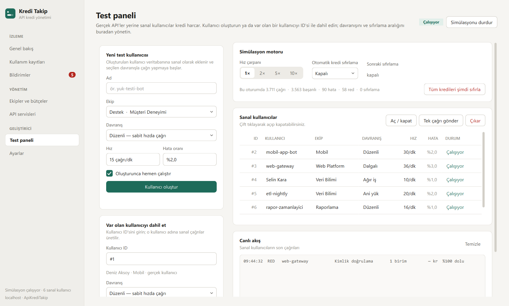

# Kullanım kılavuzu

Uygulama sol menüde üç bölümden oluşur: **İzleme**, **Yönetim** ve **Geliştirici**.
Açık ve koyu tema *Ayarlar* sayfasından değiştirilir.

## Genel bakış

* **Üst kartlar:** Açık dönemlerdeki toplam harcanan ve kalan kredi, başarılı
  çağrı sayısı ve uyarı eşiğini geçmiş ekip sayısı.
* **Dakikalık harcama:** Son 30 dakikanın kredi tüketimi. Fareyle üzerine
  gelince o dakikanın tutarı ve çağrı sayısı görünür.
* **Servis dağılımı:** Bütçenin hangi servislerde yoğunlaştığı.
* **Ekip bütçeleri:** Doluluğa göre sıralı. Çubuk rengi durumu gösterir:
  yeşil normal, turuncu uyarı eşiği geçildi, kırmızı limit doldu ya da
  eşik geçilmişken dönemde reddedilen çağrı var. Çubuk
  üzerindeki ince dikey çizgi ekibin uyarı eşiğidir.

## Kullanım kayıtları

Her API çağrısı bir satırdır. Ekip ve sonuca (başarılı / hata / reddedildi)
göre süzülebilir. *Canlı akış* kapatılırsa tablo yerinde durur, inceleme
kolaylaşır.

## Bildirimler

Uyarı eşiği geçildiğinde, kalan kredi bir çağrıya yetmediğinde, limit dolduğunda ve krediler sıfırlandığında:

* sağ altta birkaç saniye görünen bir **bildirim kartı** çıkar (tıklayınca kapanır),
* menüdeki **Bildirimler** öğesinde okunmamış sayısı görünür,
* pencere arka plandaysa kritik bildirimler **Windows bildirimi** olarak da gelir.

## Ekipler ve bütçeler

* **Yeni departman / Yeni ekip:** Ekip oluştururken ilk bütçe dönemi ve servis izinleri de tanımlanır.
* **Bütçeyi düzenle:** Limit ve uyarı eşiği (%) değiştirilir. Harcama silinmez.
* **Servis izinleri:** Ekibin hangi servisleri çağırabileceği. İzinsiz servise yapılan çağrı reddedilir.
* **Dönemi sıfırla:** Açık dönem kapatılır, sıfır harcamayla yeni dönem açılır. Geçmiş kayıtlar korunur.
* **Kullanıcılar** sekmesi: tüm kullanıcılar, ID'leri ve gerçek/sanal ayrımı.

## API servisleri

Sağlayıcılar, servisler, ücretlendirme birimi ve birim fiyatı. Fiyat değişikliği
yalnızca sonraki çağrıları etkiler.

## Test paneli

Gerçek API'ler çağrılamadığı için sistemi canlı göstermek üzere tasarlanmıştır.

**Yeni test kullanıcısı.** Ad, ekip, davranış, hız ve hata oranı seçilir.
*Kullanıcı oluştur* düğmesi `Users` tablosuna `IsSimulated = 1` olan bir
kullanıcı ve `SimulationProfiles` tablosuna davranış kaydı ekler. Oluşan ID
ekranda gösterilir. Kullanıcı birkaç saniye içinde çağrı yapmaya başlar.

**Var olan kullanıcıyı dahil et.** Herhangi bir kullanıcının ID'si girilir.
Kim olduğu altında görünür. *Simülasyona dahil et* ile o kullanıcı adına çağrı
üretilir. Örnek veride #1 (Deniz Aksoy) ve #8 (Mert Yılmaz) gerçek
kullanıcılardır. Onları bu yolla dahil edebilirsiniz.

**Simülasyon motoru.**

* *Hız çarpanı* (1×, 2×, 5×, 10×) tüm sanal trafiği hızlandırır. Sunumda limit
  aşımını birkaç saniyede göstermek için kullanışlıdır.
* *Otomatik kredi sıfırlama:* Kapalı, 1 dk, 5 dk, 15 dk, 1 saat veya 1 gün.
  Süre dolunca tüm ekiplerin dönemi kapatılıp yenisi açılır. Kalan süre yanda
  geri sayılır.
* *Tüm kredileri şimdi sıfırla:* Elle dönem sıfırlama.
* *Simülasyonu başlat/durdur:* Sağ üstteki düğme.

**Sanal kullanıcılar tablosu.** Çift tıklama veya *Aç / kapat* ile kullanıcı
duraklatılır. *Tek çağrı gönder* seçili kullanıcı adına tek bir çağrı yapar.
*Çıkar* profili siler, kullanıcı ve geçmişi kalır.

**Canlı akış.** Her çağrının saati, sonucu (`ok` / `hata` / `RED`), kullanıcı,
servis, birim, kredi ve ekibin doluluk oranı.

### Önerilen sunum senaryosu

1. Uygulamayı açın ve Test panelinden simülasyonu başlatın (`config.ini` içinde `autostart = no` ise kendiliğinden başlamaz). Genel bakışta grafiklerin dolduğunu gösterin.
2. Test panelinde *Raporlama* ekibine "sunum-bot" adında, *Ani yük* davranışlı, 120 çağrı/dk hızında bir kullanıcı oluşturun.
3. Hızı **10×** yapın. Raporlama ekibi önce %80 uyarısını, sonra "kalan kredi çağrıya yetmedi" veya "limit doldu" bildirimini alır.
4. *Kullanım kayıtları*nda sonucu "Reddedildi" olarak süzün. Limit aşımı denemeleri kredi düşmeden kaydedilmiştir.
5. *Tüm kredileri şimdi sıfırla* deyin. Genel bakışta tüm çubuklar sıfırlanır, *Bildirimler*de sıfırlama kaydı görünür.
6. SSMS'te `SELECT * FROM dbo.TeamBudgets ORDER BY TeamBudgetId` ile kapatılan ve açılan dönemleri gösterin.
