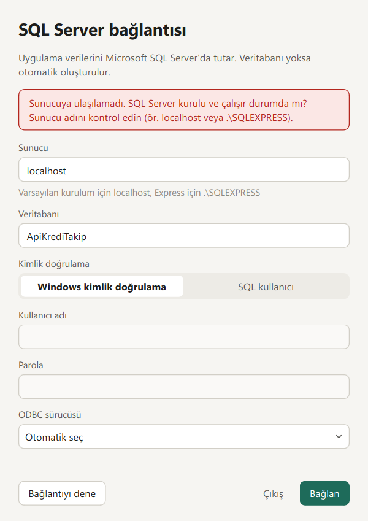

# Kurulum

## 1. SQL Server

Ücretsiz ve özellik sınırı olmayan **SQL Server Developer Edition** önerilir.
Yalnızca canlı ortamda (production) kullanılamaz, ders projesi için uygundur.
Yönetici olarak açılmış bir PowerShell'de:

```powershell
winget install Microsoft.SQLServer.2022.Developer
winget install Microsoft.msodbcsql.18
winget install Microsoft.SQLServerManagementStudio.21   # isteğe bağlı, tabloları görmek için
```

Kurulumda **varsayılan instance** ve **Windows Authentication** seçilirse
uygulama hiçbir ayar gerektirmeden `localhost`'a bağlanır.

| Kurulum | `config.ini` → `server` |
|---|---|
| Developer / varsayılan instance | `localhost` |
| Express | `.\SQLEXPRESS` |
| Docker'da çalışan SQL Server | `localhost,1433` (+ `trusted_connection = no`, `sa` kullanıcısı) |

> SQL Server Express de çalışır (10 GB veritabanı sınırı bu proje için fazlasıyla yeterli).

## 2. Python ortamı

Python 3.11 veya üstü gerekir.

```powershell
python -m venv .venv
.venv\Scripts\activate
pip install -r requirements.txt
```

## 3. Ayarlar (isteğe bağlı)

```powershell
copy config.example.ini config.ini
```

`config.ini` yoksa varsayılanlar kullanılır. Uygulama sunucuya bağlanamazsa bir
bağlantı ekranı açar. Oradan girilen bilgiler `config.ini`'ye kaydedilir.



Ortam değişkenleri dosyadaki değerleri ezer. Bu, testlerde işe yarar:
`KREDI_DB_SERVER`, `KREDI_DB_NAME`, `KREDI_DB_USER`, `KREDI_DB_PASSWORD`,
`KREDI_DB_DRIVER`.

## 4. Çalıştırma

```powershell
python main.py
```

İlk açılışta sırasıyla şunlar olur:

1. `ApiKrediTakip` veritabanı yoksa oluşturulur.
2. `core/db/schema.sql` uygulanır (tablolar, indeksler, görünüm, saklı yordam).
3. Veritabanı boşsa örnek veri yüklenir: 3 departman, 5 ekip, 4 sağlayıcı, 7 servis, 8 kullanıcı (6'sı sanal).
4. Simülasyon motoru başlar ve sanal kullanıcılar kredi harcamaya başlar.

## Sorun giderme

| Belirti | Çözüm |
|---|---|
| "Sunucuya ulaşılamadı" | `services.msc` → *SQL Server (MSSQLSERVER)* çalışıyor mu? Express ise sunucu adı `.\SQLEXPRESS` olmalı. |
| "ODBC sürücüsü bulunamadı" | `winget install Microsoft.msodbcsql.18` |
| "Oturum açılamadı" | Windows kullanıcınızın SQL Server'da oturum izni var mı? Yoksa SQL kullanıcısı ile bağlanın. |
| Sertifika hatası | `config.ini` → `trust_server_certificate = yes` |
| Veritabanını sıfırdan kurmak | SSMS'te `DROP DATABASE ApiKrediTakip;` sonra uygulamayı yeniden açın. |
