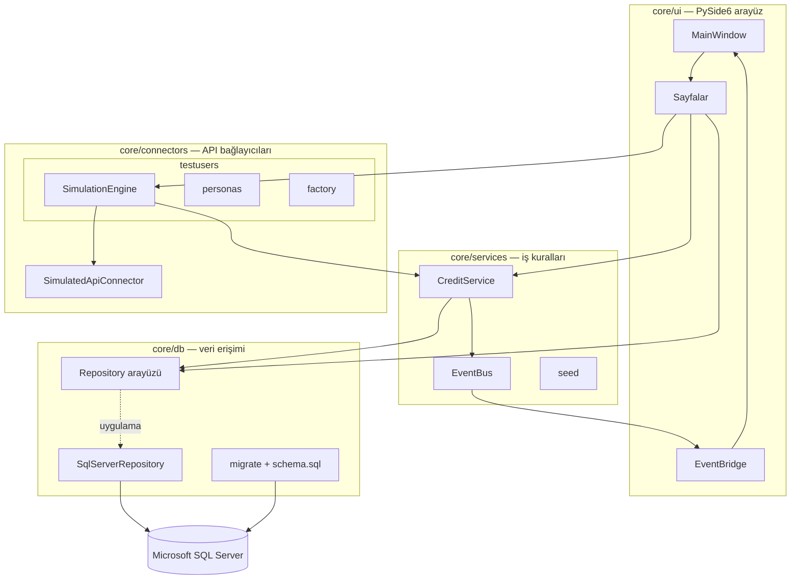
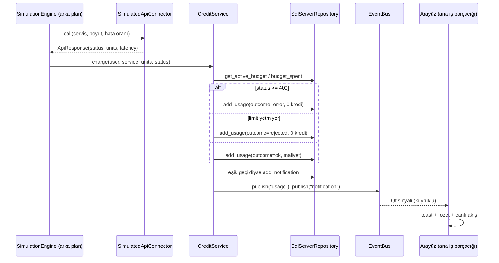

# Mimari

## Katmanlar



| Katman | Klasör | Sorumluluk |
|---|---|---|
| Arayüz | `core/ui` | Sayfalar, grafikler, bildirim kartları, tema. İş kuralı içermez. |
| İş kuralları | `core/services` | Kredi düşme, eşik bildirimleri, dönem sıfırlama, örnek veri. Qt'ye bağımlı değildir. |
| Bağlayıcılar | `core/connectors` | API çağrısı sözleşmesi (`ApiConnector`) ve sahte uygulaması. `testusers` sanal kullanıcıları çalıştırır. |
| Veri erişimi | `core/db` | `Repository` arayüzü, SQL Server uygulaması, şema ve göç. |

İş katmanı veritabanına yalnızca `Repository` arayüzü üzerinden erişir. Üretimde
`SqlServerRepository` kullanılır. Testlerde aynı sözleşmeyi uygulayan bellek içi
`tests/fakes.py::InMemoryRepository` kullanılır. Böylece iş kuralları SQL
Server olmadan da test edilebilir.

## Bir API çağrısının yolu



`charge` işlemi bir süreç içi kilit (`RLock`) ve bir veritabanı işlemi
(transaction) içinde çalışır. Böylece aynı ekibe eşzamanlı gelen iki çağrı
limiti aynı anda "boş" görüp birlikte aşamaz. Bu durum
`tests/test_credit_service.py::test_concurrent_charges_never_exceed_limit` ile
test edilir.

## İş parçacıkları

* **Ana iş parçacığı:** Qt olay döngüsü. Görünen sayfa 2 saniyede bir veritabanından yenilenir.
* **`simulation` iş parçacığı:** `SimulationEngine._run`. Her 0,5 saniyede bir adım atar.
* pyodbc bağlantıları iş parçacıkları arasında paylaşılamaz. Bu yüzden
  `ConnectionPool` her iş parçacığına kendi bağlantısını açar.
* Arka plandan gelen olaylar `EventBridge` üzerinden Qt sinyaline çevrilir.
  Qt, alıcı ana iş parçacığında olduğu için çağrıyı otomatik olarak kuyruğa
  alır. Arayüz hiçbir zaman arka plan iş parçacığından değiştirilmez.

## Kredi kuralları

| Durum | Kayıt | Kredi | Bildirim |
|---|---|---|---|
| Başarılı çağrı, limit yetiyor | `ok` | `units × CreditPerUnit` | Uyarı eşiği bu çağrıyla ilk kez geçildiyse **warning** |
| Limit tam doldu | `ok` | düşülür | **critical** "kredi limiti doldu" |
| Kalan kredi çağrıya yetmiyor | `rejected` | 0 | Dönem ve limit başına bir kez **warning** |
| Bütçe değişikliğiyle eşik geçildi | — | — | **warning**, limit harcamanın altına indiyse **critical** |
| API hata döndü (4xx/5xx) | `error` | 0 | — |
| Dönem sıfırlandı | — | yeni dönem 0'dan başlar | **info** |

Eşik kontrolü "önceki durumda eşiğin altında, şimdi eşikte veya üstünde" koşuluyla yapılır.
Böylece aynı uyarı her çağrıda tekrarlanmaz.

## Sanal kullanıcılar (`core/connectors/testusers`)

| Persona | Davranış |
|---|---|
| `steady` | Sabit hızda çağrı (Poisson dağılımı) |
| `bursty` | Çoğunlukla sessiz, ara sıra 4–10 adım süren 6 katı yük |
| `heavy` | Normal hızda ama 3 kat büyük çağrılar (daha çok token/sayfa) |
| `wave` | ~3 dakikalık periyotla 0,2× ile 1,8× arasında inip çıkan trafik |

Gerçek bir API'ye geçmek için `ApiConnector` arayüzünü uygulayan yeni bir
bağlayıcı yazmak yeterlidir. Örneğin isteği gönderip yanıttaki token sayısını
okuyan bir HTTP bağlayıcısı. `CreditService` ve veritabanı tarafı değişmez.

## Klasör yapısı

```
SaaS/
├── main.py                      # giriş noktası
├── config.example.ini           # ayar şablonu (config.ini olarak kopyalanır)
├── requirements.txt
├── core/
│   ├── app.py                   # bağlantı, göç, örnek veri, pencere
│   ├── config.py                # ayarlar (ini + ortam değişkenleri)
│   ├── models.py                # veri sınıfları
│   ├── db/
│   │   ├── schema.sql           # T-SQL şema (tablolar, görünüm, yordam)
│   │   ├── migrate.py           # veritabanı oluşturma + şema uygulama
│   │   ├── connection.py        # ODBC sürücü seçimi, bağlantı havuzu
│   │   ├── repository.py        # depo arayüzü
│   │   └── sqlserver.py         # SQL Server deposu
│   ├── services/
│   │   ├── credit_service.py    # kredi kuralları
│   │   ├── events.py            # olay yayıncısı
│   │   └── seed.py              # örnek veri
│   ├── connectors/
│   │   ├── base.py              # ApiConnector sözleşmesi
│   │   ├── simulated_api.py     # sahte API yanıtları
│   │   └── testusers/           # sanal kullanıcılar ve simülasyon motoru
│   └── ui/                      # PySide6 arayüz
├── tests/                       # pytest
└── docs/                        # bu belgeler
```
