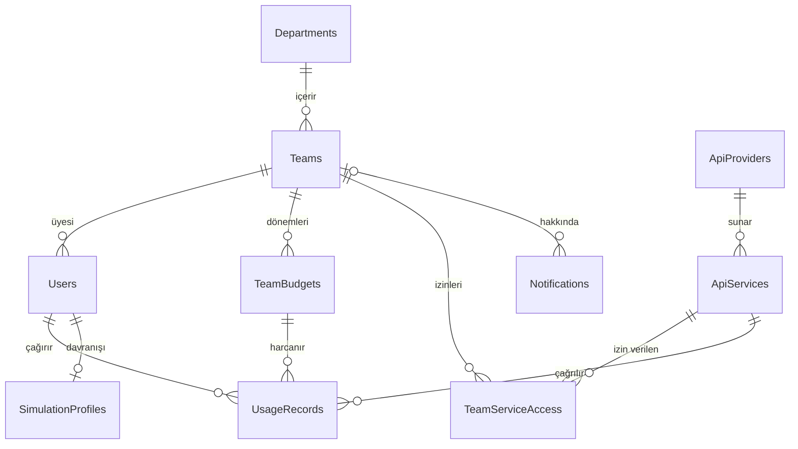

# Veritabanı tasarımı

Sistem Microsoft SQL Server üzerinde çalışır. Şemanın tamamı
[`core/db/schema.sql`](../core/db/schema.sql) dosyasındadır. Betik idempotenttir:
uygulama her açılışta çalıştırır, var olan nesnelere dokunmaz. SSMS'te elle de
çalıştırılabilir.

## Varlık–ilişki diyagramı



## Tablolar (10)

### 1. `Departments`
Şirketin departmanları. Masraf merkezi raporlamada kullanılır.

| Sütun | Tip | Kısıt |
|---|---|---|
| DepartmentId | INT IDENTITY | **PK** |
| Name | NVARCHAR(100) | NOT NULL, UNIQUE |
| CostCenter | VARCHAR(20) | NOT NULL |
| CreatedAt | DATETIME2(0) | DEFAULT SYSDATETIME() |

### 2. `Teams`
Departmanlara bağlı ekipler. Kredi limiti ekip düzeyinde tanımlanır.

| Sütun | Tip | Kısıt |
|---|---|---|
| TeamId | INT IDENTITY | **PK** |
| DepartmentId | INT | **FK** → Departments |
| Name | NVARCHAR(100) | NOT NULL; (DepartmentId, Name) UNIQUE |
| CreatedAt | DATETIME2(0) | DEFAULT |

### 3. `Users`
API çağrısı yapan kişi veya servis hesapları. `IsSimulated = 1` olanlar test
panelinden oluşturulmuş sanal kullanıcılardır.

| Sütun | Tip | Kısıt |
|---|---|---|
| UserId | INT IDENTITY | **PK** |
| TeamId | INT | **FK** → Teams |
| FullName | NVARCHAR(120) | NOT NULL |
| Email | NVARCHAR(160) | NOT NULL, UNIQUE |
| Role | VARCHAR(20) | CHECK IN ('member','lead','admin','service') |
| IsSimulated | BIT | DEFAULT 0 |
| IsActive | BIT | DEFAULT 1 |
| CreatedAt | DATETIME2(0) | DEFAULT |

### 4. `ApiProviders`
API'yi sunan kurum. `Kind` harici (`external`) veya şirket içi (`internal`) olabilir.

| Sütun | Tip | Kısıt |
|---|---|---|
| ProviderId | INT IDENTITY | **PK** |
| Name | NVARCHAR(100) | NOT NULL, UNIQUE |
| Kind | VARCHAR(10) | CHECK IN ('external','internal') |

### 5. `ApiServices`
Çağrılabilen servisler ve ücretlendirme birimi (istek, 1K token, sayfa…).

| Sütun | Tip | Kısıt |
|---|---|---|
| ServiceId | INT IDENTITY | **PK** |
| ProviderId | INT | **FK** → ApiProviders |
| Name | NVARCHAR(100) | (ProviderId, Name) UNIQUE |
| UnitName | NVARCHAR(20) | NOT NULL |
| CreditPerUnit | DECIMAL(12,4) | CHECK > 0 |
| IsActive | BIT | DEFAULT 1 |

### 6. `TeamServiceAccess`
Hangi ekibin hangi servisi çağırabileceği. Ekipler ile servisler arasındaki
çoka-çok ilişkiyi çözen bağlantı tablosudur.

| Sütun | Tip | Kısıt |
|---|---|---|
| TeamId | INT | **PK**, **FK** → Teams |
| ServiceId | INT | **PK**, **FK** → ApiServices |
| GrantedAt | DATETIME2(0) | DEFAULT |

### 7. `TeamBudgets`
Ekiplerin bütçe dönemleri. Bir ekibin aynı anda yalnızca **bir** açık dönemi
olabilir (`ClosedAt IS NULL`). Bunu filtrelenmiş benzersiz indeks
`UX_TeamBudgets_OneActive` garanti eder. Sıfırlama işlemi açık dönemi kapatıp
aynı limitle yenisini açar. Bu yüzden geçmiş harcamalar silinmez.

| Sütun | Tip | Kısıt |
|---|---|---|
| TeamBudgetId | INT IDENTITY | **PK** |
| TeamId | INT | **FK** → Teams |
| CreditLimit | DECIMAL(14,2) | CHECK > 0 |
| WarnPercent | TINYINT | CHECK BETWEEN 1 AND 99, DEFAULT 80 |
| StartedAt | DATETIME2(0) | DEFAULT |
| ClosedAt | DATETIME2(0) | NULL; CHECK ClosedAt ≥ StartedAt |
| CloseReason | NVARCHAR(120) | NULL |

### 8. `UsageRecords`
Her API çağrısı bir satırdır. Sistemin en hızlı büyüyen tablosudur.

| Sütun | Tip | Kısıt |
|---|---|---|
| UsageId | BIGINT IDENTITY | **PK** |
| TeamBudgetId | INT | **FK** → TeamBudgets |
| UserId | INT | **FK** → Users |
| ServiceId | INT | **FK** → ApiServices |
| Units | INT | CHECK > 0 |
| CreditsCharged | DECIMAL(14,4) | CHECK ≥ 0 |
| StatusCode | SMALLINT | HTTP durum kodu |
| LatencyMs | INT | |
| Outcome | VARCHAR(10) | CHECK IN ('ok','error','rejected') |
| CreatedAt | DATETIME2(3) | DEFAULT |

İndeksler: `IX_Usage_Budget (TeamBudgetId) INCLUDE (CreditsCharged, Outcome)`
dönem toplamları için; `IX_Usage_CreatedAt (CreatedAt)` zaman serisi grafiği için.

### 9. `Notifications`
Eşik uyarıları, kredi yetmedi ve limit doldu bildirimleri, sıfırlama kayıtları. `TeamId` boş
ise bildirim tüm sistemi ilgilendirir.

| Sütun | Tip | Kısıt |
|---|---|---|
| NotificationId | INT IDENTITY | **PK** |
| TeamId | INT | NULL, **FK** → Teams |
| Severity | VARCHAR(10) | CHECK IN ('info','warning','critical') |
| Title | NVARCHAR(150) | NOT NULL |
| Body | NVARCHAR(500) | NOT NULL |
| IsRead | BIT | DEFAULT 0 |
| CreatedAt | DATETIME2(0) | DEFAULT |

### 10. `SimulationProfiles`
Sanal kullanıcıların davranışı. `Users` ile bire-bir ilişkilidir. Kullanıcı
silinirse profil de silinir (`ON DELETE CASCADE`).

| Sütun | Tip | Kısıt |
|---|---|---|
| UserId | INT | **PK**, **FK** → Users |
| Persona | VARCHAR(20) | CHECK IN ('steady','bursty','heavy','wave') |
| CallsPerMinute | INT | CHECK BETWEEN 1 AND 600 |
| ErrorRate | DECIMAL(4,3) | CHECK BETWEEN 0 AND 1 |
| IsEnabled | BIT | DEFAULT 1 |

## Görünüm ve saklı yordam

**`vw_TeamBudgetStatus`**: Her ekibin açık dönemindeki limiti, harcanan kredi,
reddedilmeyen (başarılı + hatalı) ve reddedilen çağrı sayısı. Genel bakış ve Ekipler sayfası bu
görünümden okur. Harcanan tutar tabloda saklanmaz, `UsageRecords`'tan
hesaplanır. Böylece "bakiye" ile "kayıtlar" arasında tutarsızlık oluşamaz.

**`sp_ResetTeamBudget @TeamId, @Reason`**: Tek işlem (transaction) içinde ekibin
açık dönemini kilitler (`UPDLOCK, HOLDLOCK`), kapatır, aynı limit ve eşikle yeni
dönem açar ve yeni dönemin kimliğini döndürür.

## Tasarım kararları

* **Fiyat, çağrı anında kopyalanır.** `UsageRecords.CreditsCharged` çağrı
  anındaki `Units × CreditPerUnit` sonucudur. Servis fiyatı sonradan değişse
  de geçmiş harcamalar değişmez. Bu bir tekrar değil, o ana ait bir olgudur.
* **Kayıt, ekibe değil döneme bağlanır.** `UsageRecords.TeamBudgetId` çağrının
  hangi bütçeden düşüldüğünü kaydeder. Ekip bilgisi dönem üzerinden
  (`TeamBudgets.TeamId`) elde edilir. Kullanıcının ekibi ayrıca saklanmaz.
* **Bakiye saklanmaz.** Kalan kredi `CreditLimit − SUM(CreditsCharged)` ile
  hesaplanır. Ayrı bir bakiye sütunu, her çağrıda iki yerin güncellenmesini ve
  güncelleme anomalisi riskini getirirdi.
* **Reddedilen çağrılar da kaydedilir** (`CreditsCharged = 0`,
  `Outcome = 'rejected'`). Böylece limit aşımı denemeleri raporlanabilir.

## Örnek sorgular

```sql
-- Limitine en yakın ekipler
SELECT TeamName, DepartmentName, Spent, CreditLimit,
       CAST(100.0 * Spent / CreditLimit AS DECIMAL(5,1)) AS Yuzde
FROM dbo.vw_TeamBudgetStatus
ORDER BY Spent / CreditLimit DESC;

-- Açık dönemde servis bazında harcama
SELECT s.Name, SUM(r.CreditsCharged) AS Kredi, COUNT(*) AS Cagri
FROM dbo.UsageRecords r
JOIN dbo.TeamBudgets b ON b.TeamBudgetId = r.TeamBudgetId AND b.ClosedAt IS NULL
JOIN dbo.ApiServices s ON s.ServiceId = r.ServiceId
WHERE r.Outcome = 'ok'
GROUP BY s.Name
ORDER BY Kredi DESC;

-- En çok kredi harcayan 5 kullanıcı (tüm zamanlar)
SELECT TOP (5) u.FullName, t.Name AS Ekip, SUM(r.CreditsCharged) AS Kredi
FROM dbo.UsageRecords r
JOIN dbo.Users u ON u.UserId = r.UserId
JOIN dbo.Teams t ON t.TeamId = u.TeamId
GROUP BY u.FullName, t.Name
ORDER BY Kredi DESC;

-- Kapatılmış dönemlerin geçmişi
SELECT t.Name, b.StartedAt, b.ClosedAt, b.CloseReason,
       (SELECT SUM(CreditsCharged) FROM dbo.UsageRecords WHERE TeamBudgetId = b.TeamBudgetId) AS Harcanan
FROM dbo.TeamBudgets b JOIN dbo.Teams t ON t.TeamId = b.TeamId
WHERE b.ClosedAt IS NOT NULL
ORDER BY b.ClosedAt DESC;

-- Bir ekibi elle sıfırla
EXEC dbo.sp_ResetTeamBudget @TeamId = 1, @Reason = N'Ay sonu';
```
